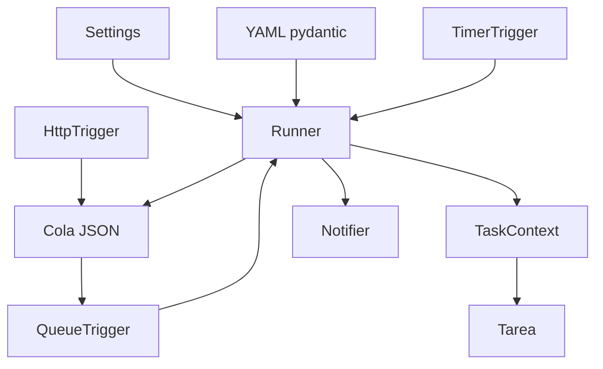

# centraal-dataframework

Librería Python para ejecutar transformaciones (pandas) y calidad de datos
([Great Expectations](https://greatexpectations.io/) 1.x) sobre
[Azure Functions](https://azure.microsoft.com/products/functions), con
programación por YAML, colas, alertas y CLI local.

> Versión actual: **0.2.0** (API con `TaskContext`). Guía:
> [Migración 0.1 → 0.2](docs/MIGRATION_0.1_to_0.2.md).

## Instalación

```bash
pip install centraal-dataframework
```

Requiere **Python 3.10–3.14** y `azure-datalake-utils>=0.6.0`.

Ese rango coincide con el runtime 4.x de Azure Functions, donde
[3.10, 3.11, 3.12, 3.13 y 3.14 están en GA](https://learn.microsoft.com/en-us/azure/azure-functions/functions-versions?pivots=programming-language-python).

En el plan **Linux Consumption**, 3.12 es la última versión: 3.13 y 3.14 no se agregan ahí. Para esas versiones hay que usar Flex Consumption, Premium o Dedicated.

## Variables de entorno

| Variable | Default | Descripción |
|----------|---------|-------------|
| `AZURE_STORAGE_CONNECTION_STRING` | — | Connection string del storage/datalake |
| `STORAGE_ACCOUNT_NAME` | — | Alternativa con Managed Identity |
| `STORAGE_CONNECTION_SETTING` | `AzureWebJobsStorage` | App setting del binding de cola |
| `QUEUE_NAME` | `tareas` | Nombre de la cola |
| `YAML_CONFIGURACION` | `centraal_dataframework.yaml` | Ruta al YAML |
| `LOGICAPP_EMAIL_URL` | — | URL HTTP de Logic App (no va en el YAML) |
| `TIMEZONE` | `America/Bogota` | Zona horaria de programación |
| `CONTENEDOR_VALIDACIONES` | `calidad-datos` | Contenedor docs/stores GX |
| `DOCS_PUBLIC_BASE_URL` | — | Base URL pública de data docs |
| `SOBREESCRIBIR_TAREA` | `true` | Permite re-registrar tareas |
| `TAREA_DEBE_CONFIGURACION` | `true` | Exige tarea en YAML al ejecutar |
| `MAX_RETRIES` | `5` | Alinear con `maxDequeueCount` |
| `HISTORY_ENABLED` | `false` | Historial en Table Storage |
| `TEAMS_WEBHOOK_URL` / `SLACK_WEBHOOK_URL` | — | Notificadores extra |
| `SAS_*` | — | Expiración/IP de SAS para reportes |

## Tareas (API 0.2)

```python
from centraal_dataframework import TaskContext, task, task_dq
import great_expectations as gx

@task
def transformar(ctx: TaskContext):
    df = ctx.datalake.read_csv("ruta/archivo.csv", sep="|")
    ctx.logger.info("filas=%s params=%s", len(df), ctx.params)

@task_dq
def validar(ctx: TaskContext):
    df = ctx.datalake.read_csv("ruta/archivo.csv", sep="|")
    result = ctx.gx.validate(
        df,
        "ventas",
        [gx.expectations.ExpectColumnValuesToNotBeNull(column="id")],
    )
    return result  # DQResult; si falla, se notifica automáticamente
```

`ctx.datalake` y `ctx.synapse` se crean al primer uso: una tarea que no los usa no necesita
su configuración.

## Synapse (serverless primero)

La tarea envía SQL a Synapse y recibe resultados pequeños (conteos, metadata). El procesamiento
pesado ocurre dentro de Synapse; los datos no viajan a la Function.

Instalar con el extra y el driver del sistema *ODBC Driver 18 for SQL Server*:

```bash
pip install "centraal-dataframework[synapse]"
```

| Variable | Default | Descripción |
|----------|---------|-------------|
| `SYNAPSE_WORKSPACE` | — | Workspace; usa `<workspace>-ondemand.sql.azuresynapse.net` (serverless) |
| `SYNAPSE_SERVER` | — | Servidor explícito (p.ej. pool dedicado); tiene prioridad |
| `SYNAPSE_DATABASE` | — | Base por defecto |
| `SYNAPSE_AUTH` | `identity` | `identity` (Managed Identity / `DefaultAzureCredential`) o `sql` |
| `SYNAPSE_USER` / `SYNAPSE_PASSWORD` | — | Solo con `SYNAPSE_AUTH=sql` (desarrollo local) |
| `SYNAPSE_QUERY_TIMEOUT` | `1800` | Segundos por consulta (límite de serverless: 30 min) |

```python
@task
def contar(ctx: TaskContext):
    bronze = ctx.synapse_for('bronze')  # otra base, misma conexión/credencial
    n = bronze.scalar("SELECT COUNT(*) FROM demo.ventas WHERE fecha = ?", ctx.params['lote'])
    ctx.logger.info("filas=%s", n)

@task
def crear_vista(ctx: TaskContext):
    # DDL: sin parámetros ?, se usa {{param}} con lista blanca; lotes separados por GO
    ctx.synapse_for('silver').execute_file('sql/vista.sql', esquema='demo', lote=ctx.params['lote'])
```

API de `SynapseClient`: `query` (lista de dicts), `scalar`, `execute` (DDL/CETAS), `read_df`
(DataFrame pequeño), `execute_file(path, **params)` y `for_database(base)`. Los valores de
`{{param}}` solo admiten letras, números y `_` separados por un `-`, `:` o `.` (fechas, ids).
Reintenta errores transitorios de conexión y throttling; no reintenta errores de SQL ni de login.

**Prueba de integración:** copie [docs/synapse.env.example](docs/synapse.env.example) a
`.env.synapse` en la raíz, complete las variables del ambiente y ejecute el notebook
[docs/synapse_integracion.ipynb](docs/synapse_integracion.ipynb) o `pytest -m synapse -v`.

## YAML de configuración

```yaml
emails_notificar:
  - equipo@example.com
tareas:
  transformar:
    dias: '*'
    horas: 8,12,20
  validar:
    dias: '*'
    horas: '*'
    depends_on: [transformar]
    params:
      fecha: "2024-01-01"
    # cron: "0 8 * * 1-5"   # opcional, reemplaza dias/horas
    # enabled: false
```

Notas de programación (`dias` = weekday ISO-like: 0=lunes … 6=domingo):

- `dias: '*'` y `horas: '*'` → cada hora, todos los días
- `dias: '*'` y `horas: '12'` → todos los días a las 12
- `dias: 0,3,6` y `horas: '*'` → lunes, jueves y domingo cada hora

## Function App

```python
import azure.functions as func
from centraal_dataframework.blueprints import framework
from mi_paquete import tareas  # noqa: F401

app = func.FunctionApp()
app.register_functions(framework)
```

Scaffold:

```bash
python -m centraal_dataframework init ./mi-proyecto
```

## CLI local

```bash
python -m centraal_dataframework validate-config -c centraal_dataframework.yaml
python -m centraal_dataframework list -m mi_paquete.tareas
python -m centraal_dataframework run transformar -m mi_paquete.tareas --params '{"fecha":"2024-01-01"}'
python -m centraal_dataframework next-runs transformar -n 5
```

## Arquitectura



## Seguridad

No versionar `centraal_dataframework.yaml` real ni `local.settings.json`.
Ver [docs/SECURITY_ROTATION.md](docs/SECURITY_ROTATION.md).

## Desarrollo

```bash
poetry install --with test,dev
poetry run pytest --cov=centraal_dataframework --cov-branch tests
```
