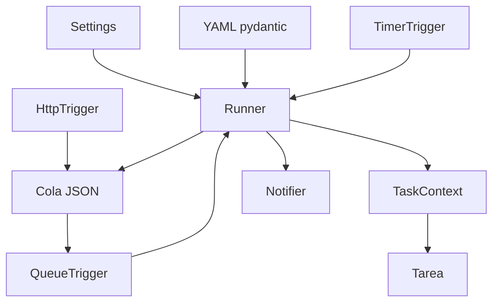

# centraal-dataframework

Librería Python para ejecutar transformaciones (pandas) y calidad de datos
([Great Expectations](https://greatexpectations.io/) 1.x) sobre
[Azure Functions](https://azure.microsoft.com/products/functions), con
programación por YAML, colas, alertas y CLI local.

> Versión actual: **0.2.0** (API con `TaskContext`). Guía:
> [Migración 0.1 → 0.2](docs/MIGRATION_0.1_to_0.2.md).

## Instalación

```bash
pip install centraal-dataframework
```

Requiere **Python 3.10–3.14** y `azure-datalake-utils>=0.6.0`.

Ese rango coincide con el runtime 4.x de Azure Functions, donde
[3.10, 3.11, 3.12, 3.13 y 3.14 están en GA](https://learn.microsoft.com/en-us/azure/azure-functions/functions-versions?pivots=programming-language-python).

En el plan **Linux Consumption**, 3.12 es la última versión: 3.13 y 3.14 no se agregan ahí. Para esas versiones hay que usar Flex Consumption, Premium o Dedicated.

**Plan recomendado: Premium (Elastic Premium, Linux) con Python 3.11 o 3.12.**
`centraal-dataframework init` genera `infra/main.bicep` para ese plan.
- La imagen de Functions trae el *ODBC Driver 18* desde Python 3.11; 3.10 trae el 17.
- No hay límite de 10 min por ejecución.
- La Function entra a Synapse con identidad administrada.
- Arranca con una instancia siempre encendida, sin escalado elástico ni pre-calentada, y ejecuta las
  tareas en serie. El timer `monitor_capacidad` avisa con `CAPACIDAD:` si hace falta otra instancia
  o una más grande.
- Regla: **N instancias = N tareas independientes a la vez.** Ver [docs/CAPACIDAD.md](docs/CAPACIDAD.md).

En Flex Consumption no se pueden instalar paquetes del sistema si el driver faltara. Después de cada
despliegue, revise `GET /api/diag`: responde 503 si una tarea perdió su driver o su configuración.

## Variables de entorno

| Variable | Default | Descripción |
|----------|---------|-------------|
| `AZURE_STORAGE_CONNECTION_STRING` | — | Connection string del storage/datalake |
| `STORAGE_ACCOUNT_NAME` | — | Alternativa con Managed Identity |
| `STORAGE_CONNECTION_SETTING` | `AzureWebJobsStorage` | App setting del binding de cola |
| `QUEUE_NAME` | `tareas` | Nombre de la cola |
| `YAML_CONFIGURACION` | `centraal_dataframework.yaml` | Ruta al YAML |
| `LOGICAPP_EMAIL_URL` | — | URL HTTP de Logic App (no va en el YAML) |
| `TIMEZONE` | `America/Bogota` | Zona horaria de programación |
| `CONTENEDOR_VALIDACIONES` | `calidad-datos` | Contenedor docs/stores GX |
| `DOCS_PUBLIC_BASE_URL` | — | Base URL pública de data docs |
| `SOBREESCRIBIR_TAREA` | `true` | Permite re-registrar tareas |
| `TAREA_DEBE_CONFIGURACION` | `true` | Exige tarea en YAML al ejecutar |
| `MAX_RETRIES` | `5` | Alinear con `maxDequeueCount` |
| `CAPACIDAD_COLA_MAX` / `CAPACIDAD_ESPERA_MAX_MIN` / `CAPACIDAD_MEMORIA_PCT` | `5` / `60` / `80` | Umbrales del monitor de capacidad ([docs/CAPACIDAD.md](docs/CAPACIDAD.md)) |
| `HISTORY_ENABLED` | `false` | Historial en Table Storage |
| `TEAMS_WEBHOOK_URL` / `SLACK_WEBHOOK_URL` | — | Notificadores extra |
| `SAS_*` | — | Expiración/IP de SAS para reportes |

## Tareas (API 0.2)

```python
from centraal_dataframework import TaskContext, task
import great_expectations as gx

@task(uses=['datalake'])
def transformar(ctx: TaskContext):
    df = ctx.datalake.read_csv("ruta/archivo.csv", sep="|")
    ctx.logger.info("filas=%s params=%s", len(df), ctx.params)

@task(uses=['datalake', 'gx'])
def validar(ctx: TaskContext):
    df = ctx.datalake.read_csv("ruta/archivo.csv", sep="|")
    result = ctx.gx.validate(
        df,
        "ventas",
        [gx.expectations.ExpectColumnValuesToNotBeNull(column="id")],
    )
    return result  # DQResult; si falla, el runner lo trata como error de calidad y notifica
```

### Recursos del contexto

Cada plataforma es un recurso distinto del contexto y cada tarea **declara** cuáles usa con `uses`:

| Declaración | Acceso |
|---|---|
| `'datalake'` | `ctx.datalake` |
| `'synapse'` | `ctx.synapse`, `ctx.synapse_for('silver')` |
| `'gx'` | `ctx.gx` |
| `'synapse:gold'` | `ctx.resource('synapse', 'gold')`: conexión con nombre |

- Usar un recurso no declarado lanza `RecursoNoDeclarado`.
- Declarar una plataforma no registrada falla al importar las tareas (`RecursoDesconocido`).
- Si un recurso declarado no tiene configuración, la tarea no se ejecuta (`RecursoNoConfigurado`).
  `python -m centraal_dataframework check-resources -m mi_paquete.tareas` revisa todas las tareas sin
  ejecutarlas y termina con código 1 si falta algo.
- Declarar no conecta: el cliente se crea al primer uso.
- Si la tarea devuelve un `DQResult` fallido, el runner lo convierte en `ErrorTareaCalidadDatos` y
  notifica. Llamada directa (`validar()` en un notebook), la tarea devuelve el `DQResult` sin lanzar.
- En la Function, un fallo de calidad se notifica en el primer intento y **no se reintenta** (los datos
  no cambian entre intentos), y sus dependientes no se ejecutan. Los demás errores se reintentan hasta
  `MAX_RETRIES` y notifican solo en el último intento.

**Conexiones con nombre.** `'datalake:curado'` usa solo las variables con sufijo `__CURADO`
(`AZURE_STORAGE_CONNECTION_STRING__CURADO`, `STORAGE_ACCOUNT_NAME__CURADO`). `'synapse:gold'` usa
`SYNAPSE_WORKSPACE__GOLD`, `SYNAPSE_DATABASE__GOLD`, etc. Los datos de conexión (cuenta, connection string,
workspace, servidor, base, usuario y clave) **no** se heredan de la conexión por defecto, para no apuntar
en silencio a otro lago o workspace. El resto (`SYNAPSE_QUERY_TIMEOUT`, `CONTENEDOR_VALIDACIONES`, `SAS_*`, …)
se hereda y se puede sobrescribir con el mismo sufijo.

**Plataformas propias.** `datalake`, `synapse` y `gx` se registran con la misma API pública:

```python
from centraal_dataframework import register_resource

register_resource('mi_api', lambda settings, ctx: MiApi(...), check=lambda settings: [])
```

`factory(settings, ctx)` recibe las Settings de la conexión (por defecto o con nombre);
`check(settings)` devuelve los problemas de configuración sin conectarse. Registre la plataforma antes
de importar las tareas que la declaran.

## Synapse (serverless primero)

La tarea envía SQL a Synapse y recibe resultados pequeños (conteos, metadata). El procesamiento
pesado ocurre dentro de Synapse; los datos no viajan a la Function.

Instalar con el extra y el driver del sistema *ODBC Driver 18 for SQL Server*:

```bash
pip install "centraal-dataframework[synapse]"
```

| Variable | Default | Descripción |
|----------|---------|-------------|
| `SYNAPSE_WORKSPACE` | — | Workspace; usa `<workspace>-ondemand.sql.azuresynapse.net` (serverless) |
| `SYNAPSE_SERVER` | — | Servidor explícito (p.ej. pool dedicado); tiene prioridad |
| `SYNAPSE_DATABASE` | — | Base por defecto |
| `SYNAPSE_AUTH` | `identity` | `identity` (Managed Identity / `DefaultAzureCredential`) o `sql` |
| `SYNAPSE_USER` / `SYNAPSE_PASSWORD` | — | Solo con `SYNAPSE_AUTH=sql` (desarrollo local) |
| `SYNAPSE_QUERY_TIMEOUT` | `1800` | Segundos por consulta (límite de serverless: 30 min) |
| `SYNAPSE_ODBC_DRIVER` | `ODBC Driver 18 for SQL Server` | Driver ODBC instalado; `check-resources` avisa si no está |

```python
@task(uses=['synapse'])
def contar(ctx: TaskContext):
    bronze = ctx.synapse_for('bronze')  # otra base, misma conexión/credencial
    n = bronze.scalar("SELECT COUNT(*) FROM demo.ventas WHERE fecha = ?", ctx.params['lote'])
    ctx.logger.info("filas=%s", n)

@task(uses=['synapse'])
def crear_vista(ctx: TaskContext):
    # DDL: sin parámetros ?, se usa {{param}} con lista blanca; lotes separados por GO
    ctx.synapse_for('silver').execute_file('sql/vista.sql', esquema='demo', lote=ctx.params['lote'])
```

API de `SynapseClient`: `query` (lista de dicts), `scalar`, `execute` (DDL/CETAS), `read_df`
(DataFrame pequeño), `execute_file(path, **params)` y `for_database(base)`. Los valores de
`{{param}}` solo admiten letras, números y `_` separados por un `-`, `:` o `.` (fechas, ids).
Reintenta errores transitorios de conexión y throttling; no reintenta errores de SQL ni de login.

**Calidad sin traer los datos:** `ctx.gx.validate_query(ctx.synapse, name, query, expectations, params=...)`
ejecuta la suite de GX en serverless (`modo='sql'`). Con `modo='pandas'` valida la misma suite sobre
`read_df`. Declare `uses=['synapse', 'gx']`. Recomendaciones de costo en
[docs/MOTOR_DE_COMPUTO.md](docs/MOTOR_DE_COMPUTO.md); para probar una versión sin publicar en una
Function, [docs/PRUEBA_EN_FUNCTION.md](docs/PRUEBA_EN_FUNCTION.md).

**Prueba de integración:** copie [docs/synapse.env.example](docs/synapse.env.example) a
`.env.synapse` en la raíz, complete las variables del ambiente y ejecute el notebook
[docs/03_synapse.ipynb](docs/03_synapse.ipynb) o `pytest -m synapse -v`.

| Síntoma | Causa probable | Qué hacer |
|---|---|---|
| `Falta pyodbc` | No se instaló el extra | `pip install -e ".[synapse]"` |
| `IM002` / `Data source name not found` | Falta el driver de `SYNAPSE_ODBC_DRIVER` | Instalar el driver del sistema o ajustar `SYNAPSE_ODBC_DRIVER` al instalado (`pyodbc.drivers()`) |
| `DefaultAzureCredential failed to retrieve a token` | No hay sesión de Azure CLI | `az login [--tenant <tenant-id>]` |
| `Client with IP address '...' is not allowed` (40615) | IP fuera del firewall del workspace | `az synapse workspace firewall-rule create ...` |
| `Login failed for user '<token-identified principal>'` (18456) | Sin usuario en esa base, o tenant distinto | `CREATE USER [...] FROM EXTERNAL PROVIDER` en la base; no reintentar en ráfaga |
| `Cannot find the CREDENTIAL` / `... is not accessible` | Sin permiso sobre la credencial del lago | `GRANT REFERENCES ON DATABASE SCOPED CREDENTIAL::[...]` |
| `EngineEdition` distinto de 11 | No es el endpoint serverless | Usar `SYNAPSE_WORKSPACE` sin `SYNAPSE_SERVER` |

## Notebooks

Checklist completo de pruebas antes de publicar (local, notebooks, Function Premium): [docs/CHECKLIST_PRUEBAS.md](docs/CHECKLIST_PRUEBAS.md).

Uno por plataforma, en [docs/](docs/). Variables locales: [docs/datalake.env.example](docs/datalake.env.example)
→ `.env` y [docs/synapse.env.example](docs/synapse.env.example) → `.env.synapse` (ambos ignorados por git).

| Notebook | Contenido |
|---|---|
| [01_datalake.ipynb](docs/01_datalake.ipynb) | Leer/escribir CSV y Parquet, link SAS, tareas con `uses=['datalake']`, conexión con nombre, runner |
| [02_great_expectations.ipynb](docs/02_great_expectations.ipynb) | La misma suite con tres orígenes: DataFrame en memoria, archivo del datalake y Synapse (`validate_query`: `modo='sql'`, donde el cómputo es de Synapse, y `modo='pandas'`). Además, fallo de calidad y `silenciar_dq`. Las secciones 1 a 3 corren sin storage |
| [03_synapse.ipynb](docs/03_synapse.ipynb) | Lecturas, `?` vs `render`, `execute_file`, varias bases, métricas en SQL + GX, runner, pandas/polars |

Limpie las salidas antes de commitear (*Clear All Outputs*): muestran datos del ambiente.

## YAML de configuración

```yaml
emails_notificar:
  - equipo@example.com
tareas:
  transformar:
    dias: '*'
    horas: 8,12,20
  validar:
    dias: '*'
    horas: '*'
    depends_on: [transformar]
    params:
      fecha: "2024-01-01"
    # cron: "0 8 * * 1-5"   # opcional, reemplaza dias/horas
    # enabled: false
    # silenciar_dq:          # opcional, ver "Silenciar una alarma de calidad"
    #   hasta: 2026-11-15
    #   motivo: "Proveedor X envía fechas nulas, ticket #123"
```

Notas de programación (`dias` = weekday ISO-like: 0=lunes … 6=domingo):

- `dias: '*'` y `horas: '*'` → cada hora, todos los días
- `dias: '*'` y `horas: '12'` → todos los días a las 12
- `dias: 0,3,6` y `horas: '*'` → lunes, jueves y domingo cada hora

### Silenciar una alarma de calidad

Cuando un fallo de calidad ya es conocido (p.ej. un proveedor envía datos malos mientras se corrige),
`silenciar_dq` lo apaga **por un tiempo**. `hasta` (fecha, incluida, en la zona horaria de la tarea) y
`motivo` son obligatorios.

Mientras está vigente, si la validación falla:

- no se lanza error, no se notifica y no se reintenta: la tarea termina como exitosa;
- las tareas que dependen de ella (`depends_on`) se ejecutan;
- solo queda en el log: `DQ silenciada hasta 2026-11-15 (motivo): N expectativas fallaron en validar`.

Al vencer, la alarma vuelve sola. `validate-config` avisa los silencios vencidos y los que vencen en los
próximos 7 días. No hay forma de silenciar una validación de manera permanente: si no debe detener nada,
no debería ser una validación de calidad.

## Function App

```python
import azure.functions as func
from centraal_dataframework.blueprints import framework
from mi_paquete import tareas  # noqa: F401

app = func.FunctionApp()
app.register_functions(framework)
```

Scaffold:

```bash
python -m centraal_dataframework init ./mi-proyecto
```

## CLI local

```bash
python -m centraal_dataframework validate-config -c centraal_dataframework.yaml
python -m centraal_dataframework list -m mi_paquete.tareas
python -m centraal_dataframework run transformar -m mi_paquete.tareas --params '{"fecha":"2024-01-01"}'
python -m centraal_dataframework next-runs transformar -n 5
```

## Arquitectura



## Seguridad

No versionar `centraal_dataframework.yaml` real ni `local.settings.json`.
Ver [docs/SECURITY_ROTATION.md](docs/SECURITY_ROTATION.md).

## Desarrollo

```bash
poetry install --with test,dev
poetry run pytest --cov=centraal_dataframework --cov-branch tests
```
